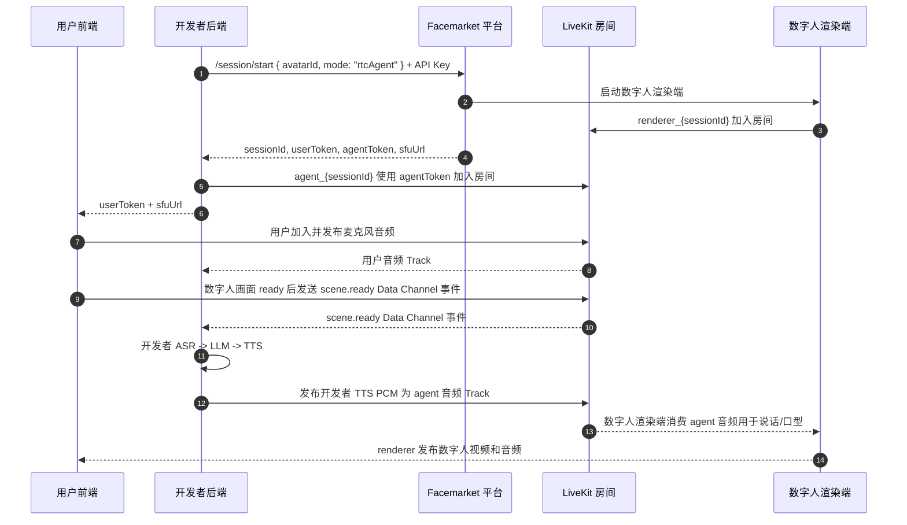

# Facemarket Platform RTC 协议

**中文** | [English](./RTC-PROTOCOL.md)


部分控制事件的语义与 [WebSocket Agent 协议](./PROTOCOL.zh.md)共用。RTC 音频输入和输出均使用 LiveKit 音频 Track，不使用 WebSocket 音频协议。
本文档描述 `liveavatar-platform-rtc` 在 `mode: "rtcAgent"` 下使用的后端协议。

Platform RTC 不同于 WebSocket Agent 模式：ASR、LLM 和 TTS 都由开发者后端
负责。平台接收数字人输出的方式是 LiveKit 音频 Track；因此 SDK 不提供
`response.chunk` 或 `response.done` 这类平台文本 TTS helper。

## 会话模型



只有后端可以持有 API Key 和 agent token。前端只接收 `userToken` 和 `sfuUrl`。

## 适用范围

本协议版本支持一个后端 RTC Agent、一个前端用户、一个数字人渲染端。

不包含：

- BYO RTC 房间或外部 SFU 所有权；
- 多用户或多个同时存在的用户音频 Track；
- 同一房间内的多数字人或多 Agent；
- 由 `response.chunk` / `response.done` 驱动的平台 TTS。

## 音频 Track

### 用户输入音频

前端将麦克风音频发布为标准 LiveKit 音频 Track，开发者 Agent 订阅该 Track 即可接收语音。音频传输不需要 WebSocket 二进制帧或语音/ASR 事件。

Python SDK 通过 `user_audio_frame` 事件输出
单声道 PCM16 帧，重采样到 `input_sample_rate`（默认 `16000` Hz）。

这些帧用于开发者自有 ASR 或 Omni 模型。

### 数字人输出音频

开发者 TTS 输出通过以下方法发布：

```python
await session.publish_audio(frame)
await session.publish_audio_stream(frames)
```

每个 `AudioFrame` 必须是单声道 PCM16，采样率必须等于协商后的输出采样率。
推荐默认值是 `24000` Hz。最终生效的输出采样率可能由会话启动响应根据数字人
配置覆盖。实时播放缓冲、必要的重采样和 Opus 编码由 LiveKit 负责。

同一时间只能有一个输出流。`session.interrupt()` 会取消本地输出流、清空待播放
队列、发送 `control.interrupt`，并触发本地 `interrupted` hook，方便应用同时
取消 LLM/TTS provider。

## 就绪事件

后端应在发布数字人语音前等待这些阶段：

1. `client.connect()` 启动平台会话，并让后端 Agent 加入 LiveKit。
2. `session.wait_for_user()` 等待前端用户加入房间。
3. `session.wait_for_scene_ready()` 等待 `scene.ready`。

`scene.ready` 表示用户侧数字人视频画面已经准备好。它不表示 ASR、LLM 或 TTS
provider 已经准备好；这些都是开发者自有资源，应由后端自行准备。

## Data Channel 事件

RTC Agent 控制事件是通过可靠 LiveKit Data Channel 发送的 JSON envelope。

SDK 根据 JSON 的 `event` 字段分发事件，不给 LiveKit Data Channel topic 赋予
协议语义。入站 packet 不会按 topic 过滤。`DataChannelEvent.topic` 仅作为诊断
元数据保留，用于观察某个 participant 是否携带了 topic。

常见入站事件：

| Event | SDK 事件 | 含义 |
| --- | --- | --- |
| `scene.ready` | `SCENE_READY` | 前端数字人视频画面已 ready |
| `scene.resourceTransition` | `SCENE_RESOURCE_TRANSITION` | renderer 即将切换视频资源 |
| `session.state` | `SESSION_STATE` | 平台会话状态更新 |
| `session.closing` | `SESSION_CLOSING` | 平台即将关闭会话 |
| `system.idleTrigger` | `IDLE_TRIGGER` | 平台侧 idle 通知 |
| `response.state` | `RESPONSE_STATE` | 某个已标识 response 的生命周期更新 |
| `error` | `ERROR` | 协议或平台错误 |
| 未知但合法的 envelope | `CUSTOM_EVENT` | 应用自定义或未来协议事件 |

### `scene.resourceTransition`

平台会在 renderer 播放完当前视频、即将切换到下一个已配置视频资源时发送该事件。
SDK 会通过 `session.on(SCENE_RESOURCE_TRANSITION)` 将它作为 `DataChannelEvent`
分发给业务处理器。

```json
{
  "event": "scene.resourceTransition",
  "requestId": "renderer_req_1",
  "timestamp": 1710000000000,
  "data": {
    "previousResourceId": "video_a",
    "nextResourceId": "video_b",
    "message": "switch from video_a to video_b"
  }
}
```

| 字段 | 位置 | 是否必填 | 含义 |
| --- | --- | --- | --- |
| `previousResourceId` | `data` | 是 | 即将切走的上一个视频资源的稳定业务 ID。它不是 URL、文件路径或展示名称。 |
| `nextResourceId` | `data` | 是 | 即将切到的下一个视频资源的稳定业务 ID。它不是 URL、文件路径或展示名称。 |
| `message` | `data` | 否 | 可选的可读说明文本，仅适合日志或排查，不要用它做业务分支判断。 |
| `requestId` | envelope | 否 | 平台生成的请求/关联 ID，用于链路追踪该通知。 |
| `timestamp` | envelope | 否 | 平台事件时间，单位为 epoch milliseconds。 |

该事件是单向通知。后端无需回复，handler 也不能确认、取消或延迟 renderer 的视频
切换。事件没有 `streamId` 字段，因为当前 RTC session 已经限定了 stream 范围。
如果任一资源 ID 缺失或为空白字符串，或者 `message` 存在但不是字符串，SDK 会派发
`protocol_error`，不会触发业务事件处理器。

可选的出站控制与通知 helper（不用于传输用户音频）：

| Method | Event | 用途 |
| --- | --- | --- |
| `send_voice_start(request_id)` | `input.voice.start` | 开发者 VAD 检测到语音开始 |
| `send_asr_partial(request_id, text, seq)` | `input.asr.partial` | 开发者 ASR 中间结果 |
| `send_voice_finish(request_id)` | `input.voice.finish` | 开发者 VAD 检测到语音结束 |
| `send_asr_final(request_id, text)` | `input.asr.final` | 开发者 ASR 最终结果 |
| `interrupt(request_id=None)` | `control.interrupt` | 取消当前数字人输出 |
| `send_prompt(text)` | `system.prompt` | 兼容的一次性 system prompt |
| `begin_prompt(request_id, response_id=None)` | `system.prompt.start` | 开始流式 system prompt |
| `begin_audio_response(request_id, response_id=None)` | `response.audio.start` | 在 RTC 音频前建立 identity |
| `send_custom_event(event, data, ...)` | 自定义 | 应用自有事件 envelope |

RTC SDK 有意不提供 `response.chunk` / `response.done` helper。数字人语音通过
开发者发布到 LiveKit 的音频 Track 传输。

## Response 生命周期

`session.state` 仍是全局 UI/会话信号，不能证明某个 response 已完成。平台发布带
identity 的生命周期事件：

```json
{
  "event": "response.state",
  "sessionId": "session-123",
  "requestId": "course-step-42",
  "responseId": "prompt-uuid",
  "seq": 128,
  "timestamp": 1788960000000,
  "data": { "state": "FINISHED", "reason": "COMPLETED" }
}
```

SDK 通过 `ResponseStateEvent` 完整暴露字段。当前 state 为 `ACCEPTED`、
`REJECTED`、`FINISHED`；reason 包括正常完成、用户/开发者打断（包括
`DEVELOPER_COMMAND_INTERRUPT`）、运行失败、
会话或请求拒绝、identity 冲突和流序号错误。state/reason 保留为字符串，未来
新增值仍会交给业务，不会导致事件循环失败。

事件按 `sessionId + seq` 去重，允许 seq 不连续。本地 response 还要求
`requestId` 匹配，第一个 `REJECTED` 或 `FINISHED` 即为最终结果。未知的本地
`responseId` 仍会发布给 `RESPONSE_STATE` 订阅者。只有目标 response 的
`FINISHED/COMPLETED` 表示成功播报完成；`IDLE`、prompt `done`、audio
`finish` 和 RTC track EOS 都不能替代它。

## 流式 system prompt

```python
prompt = await session.begin_prompt("course-step-42")
await prompt.send("现在我们来看")
await prompt.send("下一题。")
await prompt.done()
terminal = await prompt.wait_terminal(timeout=30)
```

`begin_prompt` 校验非空 ID，未指定时生成 `responseId`，并在发送
`system.prompt.start` 前完成本地注册。无需等待 `ACCEPTED` 即可发送 chunk；
chunk 复用相同 ID、携带毫秒时间戳，seq 从 1 原子递增。`done()` 幂等且只关闭
文本输入，之后 `send()` 会抛出 `PromptStreamClosedError`。取消单个 waiter
不会伪造平台终态或取消共享 response。原有 `send_prompt(text)` 保持可用。
流式 prompt 要求 dispatcher `5ad48579` 或更高的兼容版本；不要通过 session
state 事件猜测服务端是否支持。

## 带 identity 的 RTC 音频 response

```python
response = await session.begin_audio_response(request_id, response_id=None)
await response.send(frame)  # 或 response.send_stream(frames)
await response.done()
terminal = await response.wait_terminal(timeout=30)
```

`begin_audio_response` 先注册本地 response，再发送携带顶层 `requestId` 和
`responseId` 的 `response.audio.start`，之后才发布对应 RTC media track 音频。
`done()` 使用相同 ID 发送 `response.audio.finish`。finish 和 stream/track EOS
都不会合成 `FINISHED/COMPLETED`，业务必须等待 `response.state`。原有无
identity 的 `publish_audio`、`publish_audio_stream` 保持兼容。

## 错误处理

等待 helper 可能抛出：

- `SessionWaitTimeoutError`：等待阶段超时；
- `SessionClosedError`：等待或发布期间会话关闭。

音频发布可能抛出：

- `AudioFormatError`：音频不是协商输出采样率下的单声道 PCM16；
- `AudioPublishError`：LiveKit 发布失败。

未知但合法的 envelope 会保留为 `CUSTOM_EVENT`。格式错误的已知事件会派发协议
错误，而不是被静默忽略。
